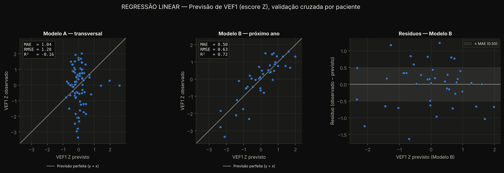
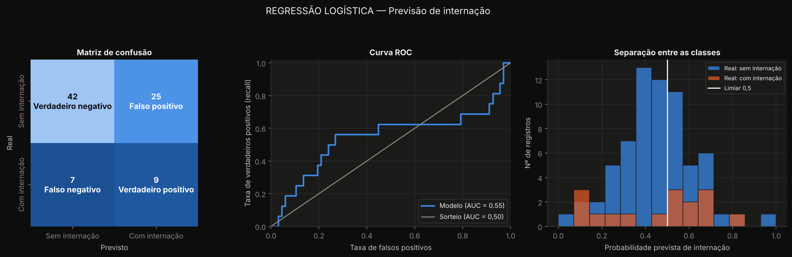
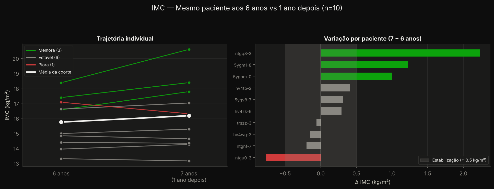
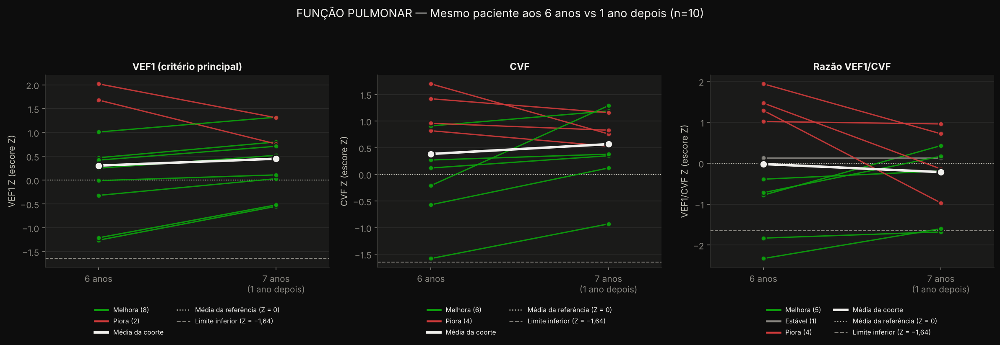
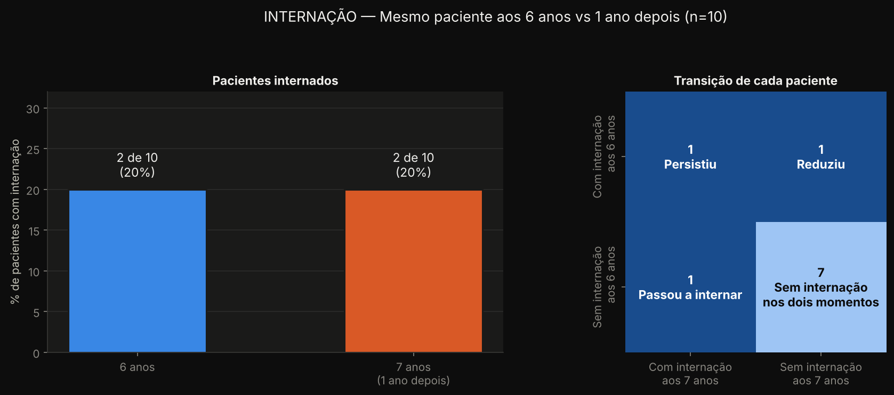
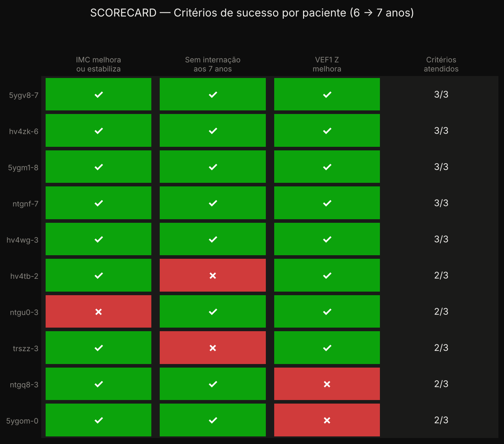

# Registros de Pacientes como Base para Decisão Clínica

### Estatística aplicada a um registro longitudinal pediátrico: IMC, função pulmonar e internações aos 6 anos vs 1 ano depois


## Sumário

1. [Objetivo](#objetivo)
2. [Resultados em uma página](#resultados-em-uma-página)
3. [A base de dados](#a-base-de-dados)
4. [Metodologia](#metodologia)
5. [Resultados detalhados](#resultados-detalhados)
6. [Como um registro de pacientes apoia decisões](#como-um-registro-de-pacientes-apoia-decisões)
7. [Limitações](#limitações)
8. [Como executar](#como-executar)
9. [Estrutura do repositório](#estrutura-do-repositório)

---

## Objetivo

Demonstrar a **utilidade de bases de registros de pacientes para a tomada de decisão**, usando um registro anonimizado de 41 pacientes entre 2022 e 2025.

O projeto responde a quatro perguntas práticas:

| Pergunta | Técnica |
|---|---|
| O que ajuda a prever a função pulmonar do paciente? | Regressão linear (MAE, RMSE, R²) |
| É possível prever quem será internado? | Regressão logística (matriz de confusão, precisão, recall, F1) |
| O tratamento teve efeitos positivos 1 ano depois? | Comparação pareada contra critérios de sucesso definidos antes da análise |
| Quem merece atenção agora? | Lista de triagem baseada em regras transparentes |

**Critérios de sucesso do tratamento**

1. **IMC** melhora ou se estabiliza (variação ≥ −0,5 kg/m²; mediana da coorte)
2. **Internações** diminuem (taxa aos 7 anos menor que aos 6)
3. **Função pulmonar** melhora (VEF1 em escore Z aumenta; mediana da coorte)

> **Importante:** este projeto é baseado no Primeiro Relatório Anual de Efetividade e Segurança para Trikafta

---

## Resultados em uma página

| | Resultado |
|---|---|
| **Regressão linear transversal** (IMC, idade, internação → VEF1 Z) | R² = **−0,16**, MAE 1,04, RMSE 1,28. Não supera a previsão pela média |
| **Regressão linear longitudinal** (registro do ano atual → VEF1 Z do ano seguinte) | R² = **0,72**, MAE 0,50, RMSE 0,63 (42 pares, 39 pacientes) |
| **Regressão logística** (prever internação) | Precisão 0,26 · recall 0,56 · F1 0,36 · AUC 0,55: **sem poder discriminativo real** |
| **6 → 7 anos, critério 1 (IMC)** | Mediana +0,30 kg/m² → **atendido** |
| **6 → 7 anos, critério 2 (internação)** | 20% → 20% → **não atendido** |
| **6 → 7 anos, critério 3 (VEF1)** | Mediana +0,30 Z, 8 de 10 melhoraram → **atendido** (p = 0,39) |
| **Veredito da coorte** | **2 de 3 critérios**; não é estatisticamente conclusivo |

**PS:** a frequência de internação foi truncada a a partir do registro de uso ou não de remédios intravenosos.

---

## A base de dados

`dados_fin.csv`: **83 registros** de **41 pacientes** (36 com 2 registros, 3 com 3 e 2 com 1), anos de seguimento 2022–2025. Sem valores ausentes nem duplicatas.

| Coluna | Descrição |
|---|---|
| `idpaciente` | Identificador anonimizado |
| `data_nasc`, `data_diagn` | Datas de nascimento e de diagnóstico de fibrose cística (dd/mm/aaaa) |
| `ano_seguimento` | Ano de consultas de seguimento |
| `imc` | Índice de massa corporal (kg/m²) |
| `internacao` | Se houve internação no ano (True/False) |
| `VEF1 Z`, `CVF Z`, `VEF1/CVF Z` | Espirometria em escore Z (0 = média da população de referência) |
| `VEF1 Predito`, `CVF Predito`, `VEF1/CVF Predito` | Espirometria em % do predito |
| `VEF1/CVF`, `VEF1/CVF Tile` | Razão de Tiffeneau e seu percentil |

**Idade.** A base traz a data de nascimento e apenas o **ano** do seguimento. A data de seguimento foi definida como **31/dez do ano** e a idade calculada como `data_seguimento − data_nasc.year`.

**Qualidade dos dados.** Um registro tem CVF Z = 6,13 (185% do predito), não sei julgar se faz sentido. Foi mantido e sinalizado.

---

## Metodologia

### Validação sem vazamento

O mesmo paciente aparece em vários registros. Um sorteio simples colocaria registros do mesmo paciente no treino e no teste e inflaria o desempenho. Todos os modelos usam **validação cruzada agrupada por paciente** (5 dobras): cada paciente fica inteiro no treino *ou* no teste, e as métricas vêm de previsões fora da amostra. Modelos são comparados a **referências ingênuas** (prever a média; repetir o último valor; alertar para todos).

### Regressão linear

| Modelo | Alvo | Preditores |
|---|---|---|
| **A. Transversal** | VEF1 Z no registro | IMC, idade, internação |
| **B. Longitudinal** | VEF1 Z do **ano seguinte** | VEF1 Z, IMC, internação e idade do ano atual |

Métricas: **MAE** (erro médio absoluto), **RMSE** (raiz do erro quadrático médio) e **R²** (coeficiente de determinação). Coeficientes com erro-padrão robusto por paciente.

### Regressão logística

Alvo: `internacao`. Preditores: VEF1 Z, VEF1/CVF Z, IMC e idade, com `class_weight='balanced'` (internação é a classe minoritária, 19%). Métricas: matriz de confusão, **precisão**, **recall**, **F1** e AUC, repetidas em 20 sorteios de dobras para medir estabilidade, mais razões de chance com IC 95% por bootstrap de pacientes.

### Comparação aos 6 anos vs 1 ano depois

Pacientes com registro aos 6 anos **e** no ano seguinte (aos 7): **n = 10**. Comparação pareada, com testes de apoio (Wilcoxon pareado; McNemar exato) usados para dizer *quanto confiar* em cada resultado, e não como condição de sucesso.

---

## Resultados detalhados

### 1. Regressão linear



| Modelo | n | MAE | RMSE | R² |
|---|---|---|---|---|
| A. Transversal | 83 | 1,04 | 1,28 | −0,16 |
| A. Referência (média) | 83 | 0,96 | 1,22 | −0,05 |
| **B. Longitudinal** | 42 | **0,50** | **0,63** | **0,72** |
| B. Só VEF1 Z do ano atual | 42 | 0,46 | 0,58 | 0,76 |
| B. Persistência (próximo = atual) | 42 | 0,45 | 0,57 | 0,77 |
| B. Referência (média) | 42 | 0,95 | 1,24 | −0,09 |

### 2. Regressão logística



| | Verdadeiro negativo | Falso positivo | Falso negativo | Verdadeiro positivo |
|---|---|---|---|---|
| Contagem | 42 | 25 | 7 | 9 |

| Métrica | Modelo | Alertar para todos |
|---|---|---|
| Precisão | 0,26 | 0,19 |
| Recall | 0,56 | 1,00 |
| F1 | 0,36 | 0,32 |
| AUC | 0,55 | 0,50 |

Em 20 repetições: F1 = 0,37 ± 0,04 e AUC = 0,56 ± 0,03. Todos os IC 95% das razões de chance incluem 1.

**Interpretação:** função pulmonar, IMC e idade **não bastam** para prever internação nesta base; a AUC próxima de 0,5 equivale a sorteio. O F1 só supera marginalmente a regra trivial de alertar todos. Esse é um achado útil: mostra que o registro precisa passar a coletar outras variáveis.

### 3. O tratamento funcionou? Aos 6 anos vs 1 ano depois (n = 10)

**IMC**



**Função pulmonar**



**Internação**



**Veredito**

| Critério | 6 anos | 7 anos | Variação | Atendido | Evidência |
|---|---|---|---|---|---|
| 1. IMC melhora ou estabiliza | 15,73 | 16,16 | +0,30 (mediana) | ✔ | Wilcoxon p = 0,16 |
| 2. Internações permanecem | 20% | 20% | 0 p.p. | Inválido | Dados tendenciosos |
| 3. Função pulmonar melhora (VEF1 Z) | 0,31 | 0,45 | +0,30 (mediana) | ✔ | Wilcoxon p = 0,39 |


**Scorecard por paciente**



5 pacientes atendem aos 3 critérios e 5 atendem a 2. O veredito da coorte esconde **quem precisa de revisão**.

### 4. Robustez: o resultado depende das escolhas?

| Cenário | Pares | Δ IMC (mediana) | Δ VEF1 Z (mediana) | Internação | Critérios |
|---|---|---|---|---|---|
| Idade em 31/dez (usado) | 10 | +0,30 | +0,30 | 20% → 20% | 2/3 |
| Idade em 30/jun | 10 | +1,09 | +0,15 | 20% → 10% | 3/3 |
| Idade em 1º/jan | 7 | +1,17 | −0,01 | 29% → 0% | 2/3 |
| Coorte ampliada (todos os pares consecutivos) | 42 | +0,64 | +0,05 | 29% → 12% | 3/3 |

O número de critérios atendidos **muda com a data de referência e a seleção**: 10 pares não sustentam uma conclusão firme. Na coorte ampliada, o IMC sobe de forma significativa (p < 0,001).

## Como um registro de pacientes apoia decisões

| Uso | O que este projeto mostra |
|---|---|
| **Priorizar acompanhamento** | O VEF1 de hoje prevê o do próximo ano com erro de ~0,5 Z; a triagem aponta quem revisar primeiro |
| **Avaliar desfechos com critérios explícitos** | Sucesso definido antes da análise, com potencial uso em decisões importantes |
| **Possibilitar avaliações com embasamento** | Validação por paciente, referências ingênuas, testes de apoio e análise de robustez impedem que um número isolado vire "prova" |
| **Crescer com o tempo** | Cada paciente e cada ano adicionam poder estatístico; a coorte ampliada já é mais informativa que a de 10 pares |

---

## Limitações

1. **Amostra pequena:** 41 pacientes, 10 na comparação 6 → 7 anos; um único paciente altera o veredito.
2. **Sem variável de tratamento nem grupo controle:** não é possível atribuir causalidade.
3. **Data de seguimento aproximada:** registra essencialmente a continuidade de tratamento, portanto dificulta a definição exata de idade.
4. **IMC bruto:** colunas com detalhes usados em IMC foram removidas.
5. **Internação binária e anual:** forma simplificada.
6. **Um valor espirométrico implausível** (CVF Z = 6,13), mantido e sinalizado.
7. **Sem validação externa:** as métricas não são um estudo real, nem é esse o intuito deste trabalho.

---

## Estrutura do repositório

```
.
├── Analise_Registro_Pacientes.ipynb   # notebook completo, com saídas
├── dados_fin.csv                      # base de registros (pseudonimizada)
├── requirements.txt
├── README.md
└── figures/                           # gráficos gerados pelo notebook
```

---

## Aviso

Projeto de caráter **educacional e demonstrativo**. Os resultados não constituem pesquisa clínica.
